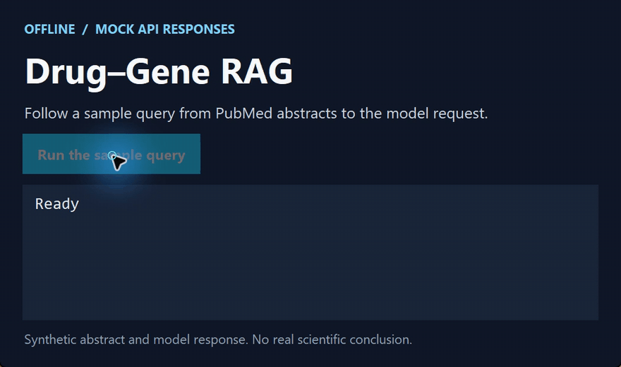

# Drug–Gene RAG

[简体中文](https://github.com/chenbinghan666/drug-gene-rag/blob/main/README.md) · [English](https://github.com/chenbinghan666/drug-gene-rag/blob/main/docs/locales/README.en.md) · [日本語](https://github.com/chenbinghan666/drug-gene-rag/blob/main/docs/locales/README.ja.md) · [Deutsch](https://github.com/chenbinghan666/drug-gene-rag/blob/main/docs/locales/README.de.md) · **Français** · [Español](https://github.com/chenbinghan666/drug-gene-rag/blob/main/docs/locales/README.es.md) · [Português](https://github.com/chenbinghan666/drug-gene-rag/blob/main/docs/locales/README.pt.md)

À partir d’un gène, d’un médicament et d’un type de cancer, l’outil récupère des résumés PubMed. Un modèle Zhipu synthétise les éléments qui étayent les associations. Conçu pour l’apprentissage et l’exploration de la littérature.

Python · PubMed · Zhipu AI

## Démonstration

Montre la requête PubMed, la récupération des résumés et l’appel au modèle avec des réponses API simulées.

[](../../docs/images/project-demo.mp4)

[Télécharger le MP4](../../docs/images/project-demo.mp4?raw=true)

## Flux fonctionnel

1. Recevez des gènes, des médicaments et des types de cancer.
2. PubMed a été recherché à l'aide de l'API NCBI Entrez.
3. Obtenez des résumés de la littérature pertinente.
4. Envoyez des preuves documentaires au modèle Intellectual Spectrum.
5. Sortez les résultats de l’analyse de la relation médicament-gène.

## Exigences environnementales

- Python 3.8 ou supérieur
- Adresse e-mail du contact NCBI
- Clé API de la plateforme ouverte Zhipu

## Comment utiliser

Installer les dépendances du projet :

```powershell
python -m pip install -r requirements.txt
```

Copiez `.env.example` vers `.env`, puis remplissez votre propre configuration :

```text
ZAI_API_KEY=your_zhipu_api_key
email=you@example.com
```

Exécutez le programme :

```powershell
python main.py
```

Les utilisateurs Windows peuvent également double-cliquer sur `run.bat`.

## Consignes de sécurité

`.env` contient une clé API privée, qui a été exclue par `.gitignore`. Veuillez ne pas le télécharger ou le partager. Les résultats du grand modèle ne sont utilisés que pour l'apprentissage et l'analyse auxiliaire de la littérature et ne peuvent pas remplacer le jugement médical professionnel.

## Documents de référence

Lai Y-J, Wang L-J, et al. *Inferring Drug–Gene Relationships in Cancer Using Literature-Augmented Large Language Models*. Cancer Research Communications, 2025.
