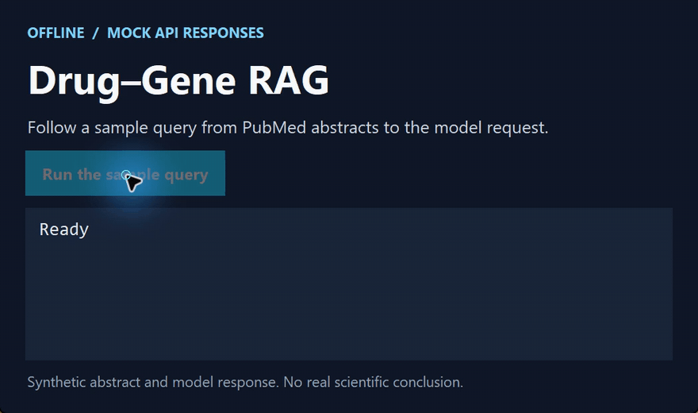

# Drug–Gene RAG

[简体中文](https://github.com/chenbinghan666/drug-gene-rag/blob/main/README.md) · [English](https://github.com/chenbinghan666/drug-gene-rag/blob/main/docs/locales/README.en.md) · [日本語](https://github.com/chenbinghan666/drug-gene-rag/blob/main/docs/locales/README.ja.md) · [Deutsch](https://github.com/chenbinghan666/drug-gene-rag/blob/main/docs/locales/README.de.md) · [Français](https://github.com/chenbinghan666/drug-gene-rag/blob/main/docs/locales/README.fr.md) · [Español](https://github.com/chenbinghan666/drug-gene-rag/blob/main/docs/locales/README.es.md) · **Português**

A partir de um gene, um fármaco e um tipo de câncer, a ferramenta recupera resumos do PubMed. Um modelo da Zhipu resume as evidências de associação. Foi criada para aprendizado e exploração da literatura.

Python · PubMed · Zhipu AI

## Demonstração

Mostra a consulta ao PubMed, a recuperação de resumos e a chamada ao modelo com respostas simuladas.

[](../../docs/images/project-demo.mp4)

[Baixar MP4](../../docs/images/project-demo.mp4?raw=true)

## Fluxo funcional

1. Receba genes, medicamentos e tipos de câncer.
2. PubMed foi pesquisado usando a API NCBI Entrez.
3. Obtenha resumos da literatura relevante.
4. Envie evidências documentais para o modelo do Espectro Intelectual.
5. Produza os resultados da análise da relação medicamento-gene.

## Requisitos ambientais

- Python 3.8 ou superior
- E-mail de contato do NCBI
- Chave de API da plataforma aberta Zhipu

## Como usar

Instale as dependências do projeto:

```powershell
python -m pip install -r requirements.txt
```

Copie `.env.example` para `.env` e preencha sua própria configuração:

```text
ZAI_API_KEY=your_zhipu_api_key
email=you@example.com
```

Execute o programa:

```powershell
python main.py
```

Os usuários do Windows também podem clicar duas vezes em `run.bat`.

## Instruções de segurança

`.env` contém uma chave de API privada, que foi excluída por `.gitignore`. Por favor, não carregue ou compartilhe. O grande resultado do modelo é usado apenas para aprendizagem e análise auxiliar de literatura e não pode substituir o julgamento médico profissional.

## Artigos de referência

Lai Y-J, Wang L-J, et al. *Inferring Drug–Gene Relationships in Cancer Using Literature-Augmented Large Language Models*. Cancer Research Communications, 2025.
